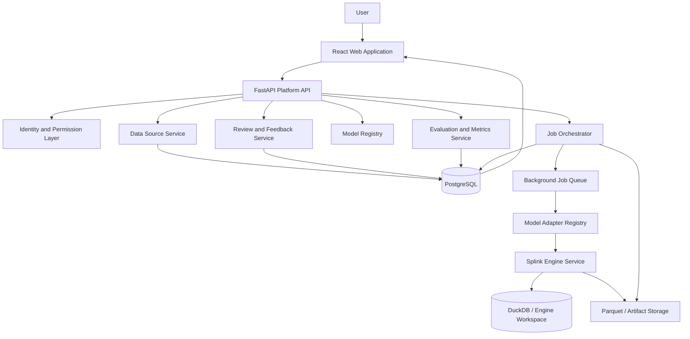

# Proposed System Architecture

## Product boundary

Nexus is the platform shell. It owns data-source metadata, dataset lifecycle, processing jobs, review workflow, model registration, analytics presentation, run history, and persistence orchestration. A model/processing engine owns its own execution logic behind a stable adapter contract.

## Logical architecture



The queue, identity provider, and artifact storage are architectural options, not implemented services. Select concrete technologies only after expected data volume, execution time, deployment environment, and access-control requirements are known.

## Responsibility boundaries

### React frontend
- Renders the 10 application areas and user workflows.
- Calls FastAPI using typed request/response contracts.
- Does not contain database credentials or model execution code.
- Handles loading, empty, error, and permission states.

### FastAPI platform backend
- Validates requests and access permissions.
- Orchestrates dataset, job, model-registry, review, and export services.
- Persists platform metadata and job state in PostgreSQL.
- Schedules long-running execution rather than keeping HTTP requests open for the full pipeline.
- Exposes normalized results to the UI.

### Model adapter

Suggested conceptual contract:

```python
class ProcessingEngineAdapter:
    def describe(self) -> dict: ...
    def validate_input(self, dataset_ref: dict, config: dict) -> dict: ...
    def execute(self, job_context: dict) -> dict: ...
    def get_status(self, execution_id: str) -> dict: ...
    def get_outputs(self, execution_id: str) -> dict: ...
```

This is a design sketch, not repository code. Adapt it to the real modules and execution semantics found during the source audit.

### First engine: Splink
- Keep Splink-specific logic in an engine service/adapter.
- Preserve the repository's validation, standardization, blocking, scoring, decision, human-review, clustering, master-record, feedback, evaluation, and incremental semantics where supported by source code.
- Do not reimplement its model logic in React.
- Do not assume every Streamlit page maps to a backend service; inspect source dependencies first.

## Data flow

1. Register a file or database source.
2. Validate source schema and map columns.
3. Register dataset metadata and immutable source reference.
4. Create a processing job with dataset, engine, config, and destination reference.
5. Queue the job and return a job ID.
6. Execute the selected adapter and report stage progress.
7. Persist artifacts, decisions, review items, entity membership, and summary metadata.
8. Review `REVIEW` items with audit history.
9. Confirm an output destination and write results transactionally.
10. Expose job results and evaluation data to the UI.

## Non-negotiable safeguards
- Preserve original source data; write to staging/output tables.
- Use explicit destination allowlists and least-privilege database roles.
- Store passwords and secrets only on the server side.
- Track dataset, model version, configuration, run ID, timestamps, and output references.
- Do not treat a model score as an automatically approved merge.
- Do not present demo numbers as measured production metrics.
